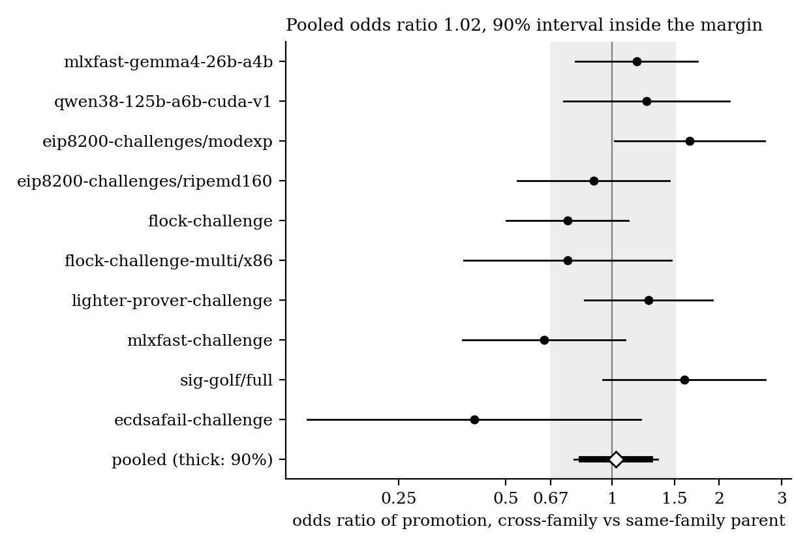

# pollen

Does cross-model pollination help open autoresearch?

On open leaderboards like [ECDSA.Fail](https://ecdsa.fail), hundreds of people point their own AI agents at one shared problem and build on each other's public submissions. A common story for why this works so well is cross-model pollination: work produced by one vendor's model gets better when a different vendor's model picks it up. This repository tests that story on the public record of ten [Yukon](https://yukon.org) leaderboards, with a pre-registered design, and holds the paper, the code, the frozen data checksums and the lock that proves the analysis was fixed before the outcomes were looked at.

## Result

Building on another participant's work from a different model vendor does not change the odds of promotion, on average across benchmarks.

| | Odds ratio | 95% interval | 90% interval | Verdict |
|---|---|---|---|---|
| Pooled, 10 benchmarks | 1.02 | 0.78 to 1.34 | 0.82 to 1.28 | equivalent to no effect |
| ECDSA.Fail alone | 0.41 | 0.14 to 1.21 | 0.16 to 1.01 | inconclusive |



The contrast is within participant: each solver's attempts that build on someone else's cross-family work are compared with that same solver's attempts that build on someone else's same-family work. The equivalence margin is a factor of 1.5 on the odds, [0.67, 1.50]. It was widened from [0.80, 1.25] by a rule written into the specification before the snapshot was frozen, because simulated power at the narrower margin was 63%. Under the narrower margin the pooled result would be inconclusive.

What the result does not say:

- It is an average. The 90% prediction interval for a single new benchmark is 0.61 to 1.72, so individual leaderboards can still differ.
- It counts submitted work only. Attempts that never reached the leaderboard are invisible.
- Model labels are self-declared. In an audit of 200 notes, 93.2% of the notes that mention a model agree with the declared one.
- Different people can still matter even if different models, as declared, do not. The ECDSA.Fail paper's observation that plateaus were broken by other participants is a different and broader claim.

All nine pre-registered sensitivity analyses give pooled odds ratios between 1.01 and 1.03. The paper is [`paper/main.pdf`](paper/main.pdf).

## What is in the data

The study uses one frozen snapshot of the public Yukon API, fetched without credentials on 18 October 2026: 48 benchmarks and 47,525 submissions, of which 32,574 belong to the ten study benchmarks and 30,687 were scored.

For every scored submission the pipeline records:

- the declared model, mapped to a vendor family by a checked-in table of 767 exact strings (`families/table.yaml`);
- the parent it built on, from Yukon's structured attribution record, a `Base:` line in the note, or the nearest promoted code tree by line diff;
- whether the parent came from another solver and another family;
- promotion, gain size, large jumps and plateau breaks, computed in evaluation order.

The ten benchmarks were chosen by a fixed rule (enough rows, enough promotions, at least two families with 10% each, recoverable code trees), with ECDSA.Fail always included.

| Benchmark | Rows |
|---|---|
| davidtai/mlxfast-gemma4-26b-a4b | 3,239 |
| davidtai/qwen38-125b-a6b-cuda-v1 | 5,757 |
| eigenlabs/eip8200-challenges/modexp | 1,512 |
| eigenlabs/eip8200-challenges/ripemd160 | 1,233 |
| eigenlabs/flock-challenge | 4,632 |
| eigenlabs/flock-challenge-multi/x86 | 3,392 |
| eigenlabs/lighter-prover-challenge | 8,379 |
| eigenlabs/mlxfast-challenge | 1,904 |
| eigenlabs/sig-golf/full | 933 |
| gpsanant/ecdsafail-challenge | 1,593 |

## Pre-registration and lock

The design was written down before any outcome was joined to a treatment. The tag `prereg-v1` (commit `09c0815`) locks a manifest, `docs/prereg-manifest.json`, with the SHA-256 of the pre-registration text, every analysis code file, the label and denominator tables, and the checksum files of the frozen data. Every analysis driver refuses to run unless the lock check passes, and the margin is read from one line of `docs/prereg.md`.

The tag's commit hash is timestamped in Bitcoin with [OpenTimestamps](https://opentimestamps.org). The proof is `docs/timestamps/prereg-v1.commit.ots`, and anyone can check it at opentimestamps.org or with `ots verify`.

Changes after the lock are listed in `docs/DEVIATIONS.md`. There are none to the locked analysis. The file also records one mismatch found afterwards: the locked code sends a fit to Firth's penalised likelihood when any coefficient or standard error exceeds 15, a rule the pre-registration text does not state.

Some outcomes on ECDSA.Fail were looked at before the lock, in crude form. The paper (Section 4.7) and the specification list them with their numbers. No outcome on any other benchmark was split by model family before the lock.

## Reproduce

Requirements: [uv](https://docs.astral.sh/uv/), Python 3.12, git, and about 500 MB of disk for the data.

```bash
git clone https://github.com/owizdom/pollen
cd pollen
uv sync
```

The frozen data is not in git. Download the data archive from Zenodo (DOI: pending) and unpack it at the repository root, so that `snapshot/raw/` and `lineage/frozen/` exist. Then:

```bash
uv run python -c "from analysis import lock; lock.check()"   # verifies code and data against prereg-v1
make reproduce                                               # every result, figure and number, offline
make check                                                   # 466 tests; fails if any test is skipped
```

`make reproduce` takes about six minutes on a laptop and needs no network. It rewrites `results/*.json`, `paper/numbers.tex` and the forest plots. The descriptive numbers and paper figures come from `tools/paper_numbers.py` and `tools/paper_figures.py`, which sit outside the lock and feed no pre-registered estimate. To build the paper, run `pdflatex`, `bibtex` and `pdflatex` twice in `paper/`.

To refetch from the live API instead, `make snapshot` writes a new freeze. The result will differ from the paper, because the leaderboards keep moving.

## Layout

```
snapshot/   fetch and checksummed loader for the frozen API snapshot
families/   declared model string to vendor family, and the label audit
lineage/    code trees, line-diff distances, parents, the confirmatory window
outcomes/   denominator rules, promotion recomputation, gains, jumps, Pareto points
analysis/   treatment frames, models, confirmatory and secondary tests, lock, numbers
tools/      power gate, pre-registration builder, descriptive paper numbers and figures
results/    the JSON every number in the paper comes from
paper/      LaTeX source, generated numbers and tables, figures, compiled PDF
docs/       specification, pre-registration, manifest, timestamp, deviations, journal
tests/      one module per domain folder
```

## Conflict of interest and AI use

I am solver `owizdom` on ECDSA.Fail, with five submissions on 2 June 2026, and a listed author of the ECDSA.Fail paper whose prose claims this study tests. Sensitivity analysis 7 drops my rows; none of them is in the primary sample.

The code was written by Claude agents under my direction and reviewed by separate Claude agents against the specification, and the label audit was scored by Claude Opus 5.5. Those reviewers share weights with the code's authors, so outside statistical review is welcome. Open an issue.

## Cite

```bibtex
@misc{okechukwu2026pollen,
  author = {Okechukwu, Wisdom},
  title  = {Does Cross-Model Pollination Help Open Autoresearch? Evidence from Yukon Leaderboards},
  year   = {2026},
  url    = {https://github.com/owizdom/pollen}
}
```

## License

MIT. The snapshot is a copy of public Yukon API responses, including public submission notes written by their authors.
